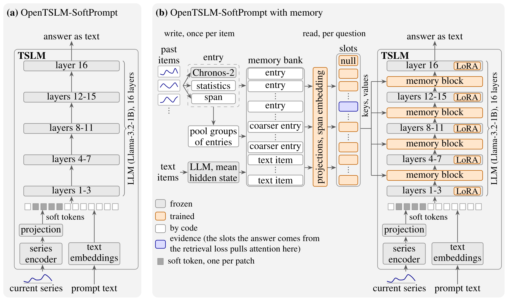

# tslm-memory

Memory for time-series language models (TSLMs). A TSLM answers each question from the series in
its prompt alone. This project gives it a memory of an entity's history, such as a household's
earlier days or the rest of a long ECG recording. Each past item is written once to a memory
bank, and cross-attention layers added inside the LLM read the bank when the model answers. The
base TSLM is OpenTSLM-SoftPrompt on Llama-3.2-1B.



(a) The base TSLM for reference (OpenTSLM-SoftPrompt with Llama-3.2-1B). (b) The same TSLM with
the memory system.

## Results

The tables compare three systems. Memory is the full system. Compression reads the same bank as
the mean of 64 equal time chunks, so it differs from memory only in whether single items are
kept. No memory is the same model trained with an empty bank. Every value is accuracy on the
test split, as the mean over 3 seeds.

Low Carbon London, 512 test questions per family from 200 households not seen in training. The
memory holds up to 830 days before the current day, and the prompt holds the current day.

| Family | Example question | Memory | Compression | No memory |
| --- | --- | --- | --- | --- |
| Day total | What was the total electricity use 12 days before today, in kWh? | **0.88** | 0.30 | 0.17 |
| Last above X | How many days before today did daily use last exceed 15 kWh? | **0.69** | 0.08 | 0.01 |
| Count | On how many of the last 14 days did daily use exceed 9 kWh? | **0.54** | 0.39 | 0.20 |
| Usual day | Was today's total use higher, lower or about the same as on a usual Monday over the last 8 weeks? | **0.89** | 0.82 | 0.51 |
| Last high price | How many days before today was the last day with a high electricity price? | **0.65** | 0.16 | 0.15 |
| Month change | Was the total use last month higher, lower or about the same as in the same month a year before? | **0.92** | 0.89 | 0.60 |
| Month total | What was the total electricity use last month, in kWh to the nearest 10? | **0.93** | 0.28 | 0.10 |
| Today only | At which hour of the day, from 0 to 23, was today's use highest? | 0.47 | 0.46 | **0.56** |
| Average | | **0.75** | 0.42 | 0.29 |

TS-Haystack, ECG recordings of 15 min, 1 h and 2 h from 9 test patients. The prompt holds only
the question. The memory holds either the recording's annotated events or the ECG itself in 10 s
segments.

| Tasks | Example question | Events, memory | Events, compression | Segments, memory | Segments, compression | No memory |
| --- | --- | --- | --- | --- | --- | --- |
| Presence | Is there any atrial bigeminy episode in this ECG window? | **0.96** | **0.96** | **0.86** | 0.84 | 0.68 |
| Order and time | Between which timestamps does the 5th atrial fibrillation episode fall? | **0.61** | 0.28 | **0.21** | 0.19 | 0.21 |
| Counting, antecedent | How many times does atrial bigeminy occur in this recording? | **0.79** | 0.70 | **0.57** | 0.53 | 0.39 |
| Average | | **0.73** | 0.53 | **0.43** | 0.41 | 0.35 |

The standard deviation between seeds is at most 0.04 on London and 0.02 on TS-Haystack.

## Setup

Requires [uv](https://docs.astral.sh/uv/), which installs Python 3.14 and the dependencies, and
one GPU with 16 GB. Llama-3.2-1B is gated on Hugging Face, so request access to
`meta-llama/Llama-3.2-1B` and log in with `hf auth login`.

```bash
uv sync
uv run pytest
```

## Data

Both datasets are open. They go under `data/`, which is not in the repository.

- Low Carbon London smart meters (London Datastore, CC BY 4.0). Put `CC_LCL-FullData.csv` from
  `LCL-FullData.zip` and `Tariffs.xlsx` in `data/lcl/raw/`.
- TS-Haystack on the Long-Term AF Database (arXiv 2602.14200). Put the Hugging Face dataset
  `nz00shuuuu/ltaf-haystack-fixed` in `data/tshaystack/ltaf_haystack` and unpack the PhysioNet
  Long-Term AF Database 1.0.0 so that its records are in `data/tshaystack/ltafdb/files`.

The memory entries are written once, with the frozen Chronos-2 encoder.

```bash
uv run python -m tslm_memory.lcl          # London days of 48 readings and the household split
uv run python -m tslm_memory.encode       # London day entries
uv run python -m tslm_memory.ltaf_tiles   # ECG entries
```

## Reproducing the results

```bash
scripts/reproduce.sh
```

The script trains and scores every system in the tables and then runs
`uv run python -m tslm_memory.report`, which writes both tables, the results figure and the
numbers the discussion cites to `runs/report`. It holds the exact command of every run. All of it
takes about a day and a half on one RTX 4080. `scripts/reproduce.sh 0` runs one seed, in about
14 hours.

Every run is seeded. On the same machine, London training repeats bit for bit, and so does
scoring a trained model on either benchmark. TS-Haystack training does not, because the attention
kernel PyTorch uses in the backward pass is not deterministic. A retrained TS-Haystack model
therefore matches the table within the seed spread, and the same holds for both benchmarks on
other hardware or library versions.

No trained weights are published. Each run writes its log, weights and test results to
`runs/london/<name>` or `runs/haystack/<name>`, and the script skips a run whose test results
exist, so it can be started again after a stop.

## Code

All modules are in `src/tslm_memory`.

- `memory.py` is the memory, shared by both benchmarks. It has the entries and their pyramid of
  coarser entries, the span embedding, the cross-attention blocks and the compression baseline.
- `tslm.py` loads the base TSLM, adds LoRA and computes the answer loss.
- London uses `lcl.py` (data), `encode.py` (entries), `questions.py` (the eight question
  families), `train.py` and `evaluate.py`.
- TS-Haystack uses `ltaf.py` (data), `ltaf_tiles.py` (entries), `haystack.py` (training and
  scoring) and `haystack_score.py` (the benchmark's scoring rules).
- `report.py` builds the tables and the figure.

`scripts/lane.sh` runs a file of jobs in order, detached from the shell, with `lane_status.sh`
and `lane_wait.sh` to follow it. The header of each script has its usage.

## Use of AI

AI was used to help with coding and also to verify the results. In addition I used AI after I was
done to remove all redundant and dead code and polish it up for delivery.
